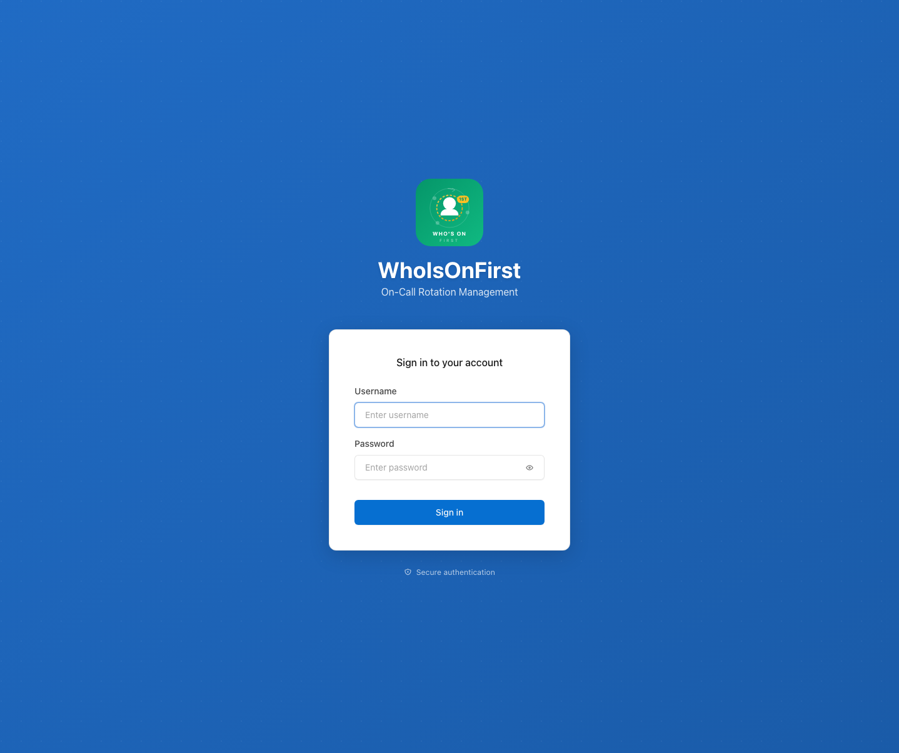
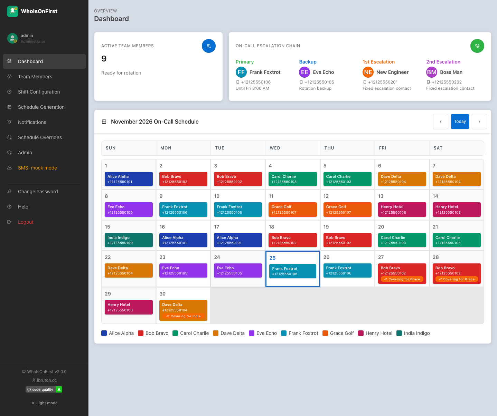
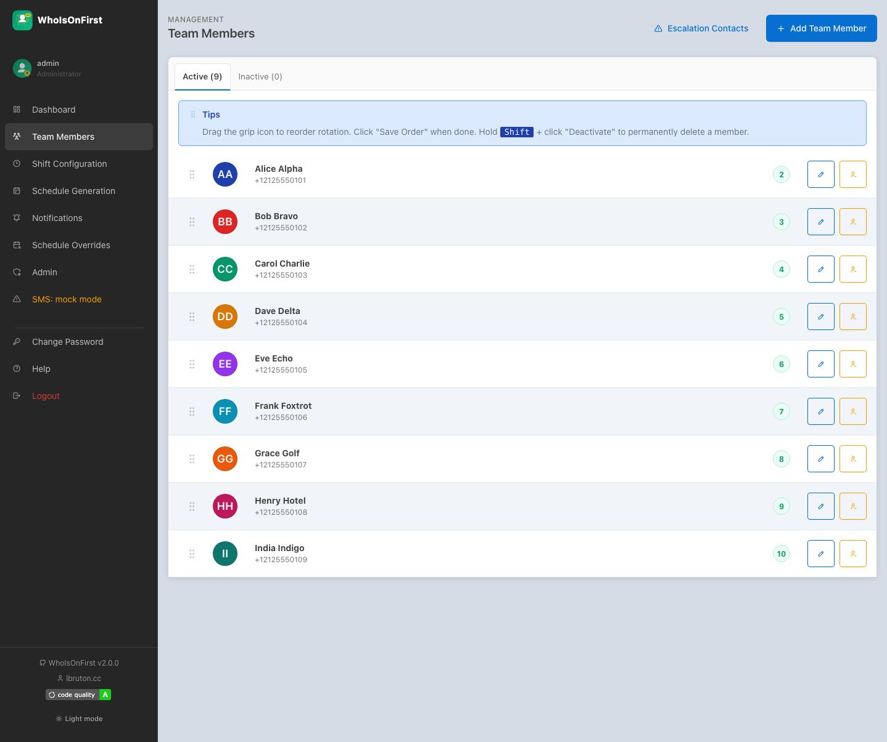
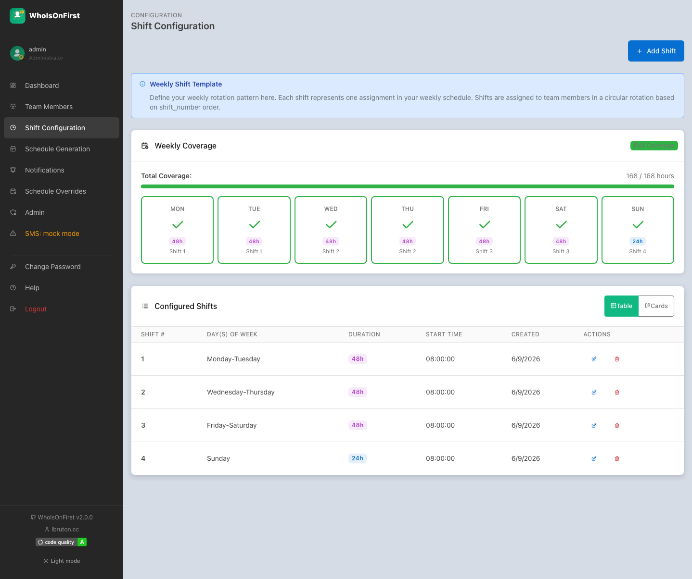
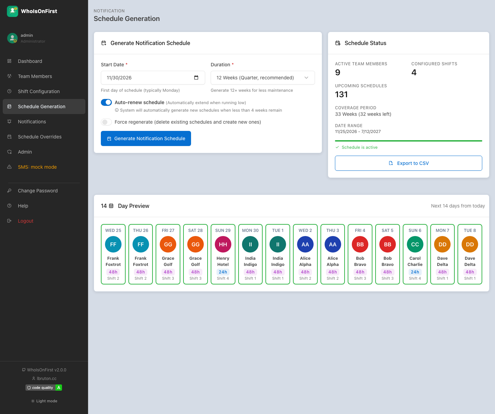
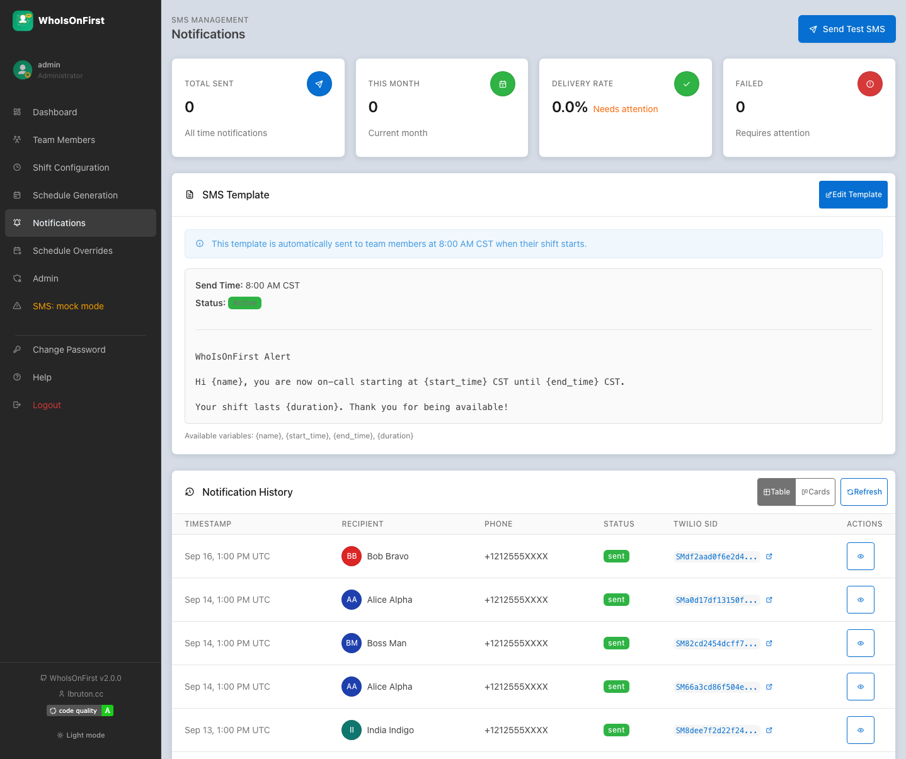
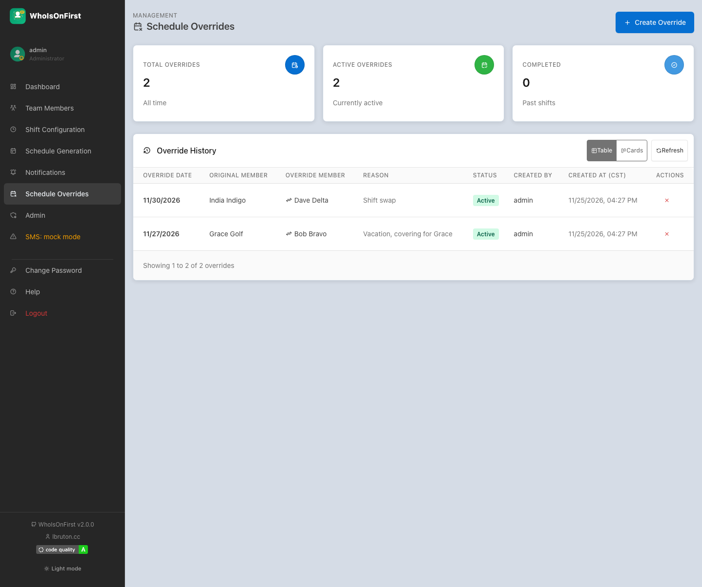
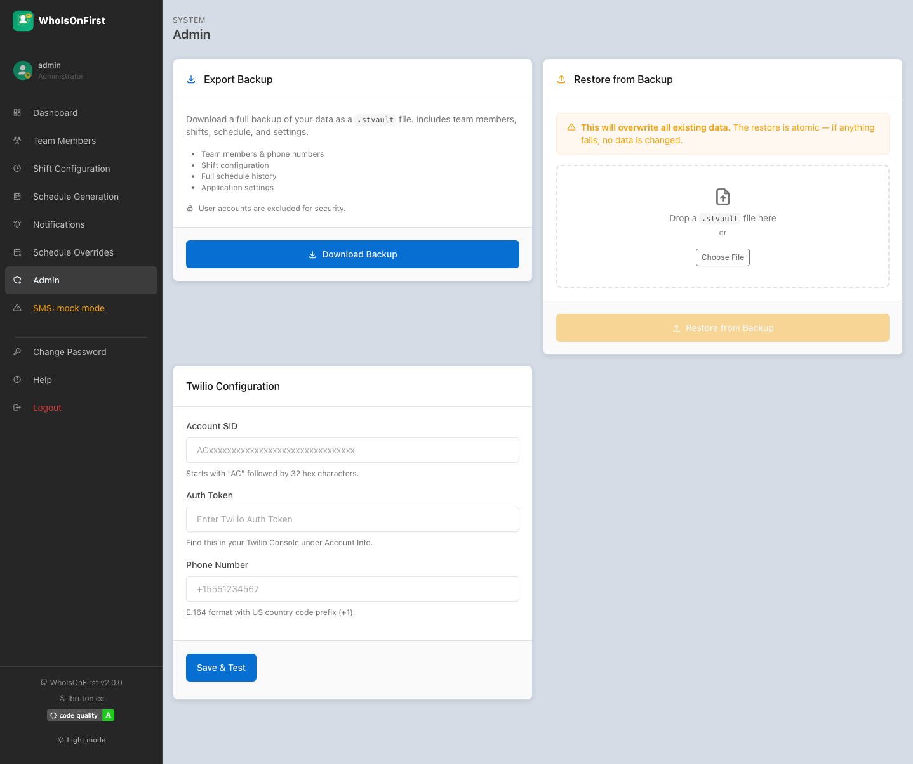
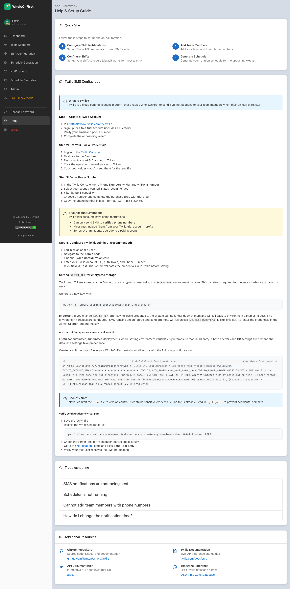

<p align="center">
  
</p>

<p align="center">
  <strong>On-call rotation and SMS notification system</strong>
</p>

<p align="center">
  <a href="https://www.python.org/"></a>
  <a href="https://fastapi.tiangolo.com/"></a>
  <a href="CHANGELOG.md"></a>
  <a href="https://app.codacy.com/gh/lbruton/WhoIsOnFirst/dashboard"></a>
</p>

---

WhoIsOnFirst assigns on-call shifts to a team and texts the person on call each morning. A circular rotation gives every member the same share of shifts in a fixed order.

## Features

- **Roles:** an admin edits the roster, shifts and settings. A viewer can only read.
- **Shifts:** 24-hour and 48-hour shifts, each mapped to one or two days of the week.
- **SMS:** Twilio sends a daily message at 8:00 AM Central from an editable template.
- **Escalation:** two fixed escalation contacts sit behind the rotation. A Monday digest of the week's schedule goes to the contacts and digest-only recipients that an admin selects.
- **Overrides:** an admin can hand one shift to another member for vacation, sick leave or a swap.
- **Order:** drag members to change the rotation order.
- **Backup and restore:** export the data to a `.stvault` file and restore it in one atomic step.

---

## Screenshots

The screenshots use sample data: placeholder names and 555 phone numbers.

### Login

Sign in with an admin or viewer account.

<p align="center">
  
</p>

### Dashboard

The dashboard shows who is on call, the escalation chain and a monthly calendar with one color for each member.

<p align="center">
  
</p>

### Team Members

Add, edit and deactivate members. Drag the grip icon to change the rotation order.

<p align="center">
  
</p>

### Shift Configuration

Define the weekly shift template. The coverage chart marks days that no shift covers.

<p align="center">
  
</p>

### Schedule Generation

Generate the schedule weeks ahead. Auto-renew extends it when fewer than four weeks remain. Export it to CSV.

<p align="center">
  
</p>

### Notifications

Edit the SMS template and read the send history with its delivery status.

<p align="center">
  
</p>

### Schedule Overrides

The override history lists who covered which shift, for whom and why.

<p align="center">
  
</p>

### Admin

Export a backup, restore one and enter the Twilio account details. A failed restore changes no data.

<p align="center">
  
</p>

### Help

The help page walks through the Twilio setup and lists the environment variables and common problems.

<p align="center">
  
</p>

---

## Technology

| Component | Technology |
| --- | --- |
| Backend | FastAPI, Python 3.12 |
| Database | SQLite with the SQLAlchemy ORM |
| Scheduler | APScheduler |
| SMS | Twilio |
| Frontend | Vanilla JavaScript, Tabler |
| Container | Red Hat UBI 9 (runs on OpenShift) |

## Run it

```bash
git clone https://github.com/lbruton/WhoIsOnFirst.git
cd WhoIsOnFirst
cp .env.example .env    # set SECRET_KEY and the Twilio values
docker compose up -d
```

Open `http://localhost:8900`. The first start creates the account `admin` with the password `Admin123!`. Change it after the first sign-in.

Local development uses `docker-compose.dev.yml`, which mocks every SMS send. `CLAUDE.md` has the details.

## Documentation

- [`.context/`](.context/README.md): architecture, code patterns, authentication and the technical stack.
- [`DocVault/`](DocVault/Overview.md): the product overview, PRD, roadmap and runbooks.
- [`CHANGELOG.md`](CHANGELOG.md): the release history.

## Acknowledgments

- [FastAPI](https://fastapi.tiangolo.com/): web framework
- [Twilio](https://www.twilio.com/): SMS delivery
- [Tabler](https://tabler.io/): UI components
